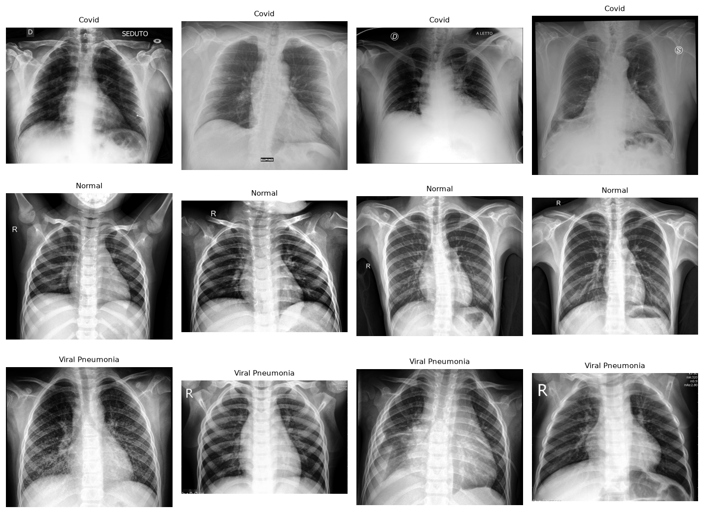
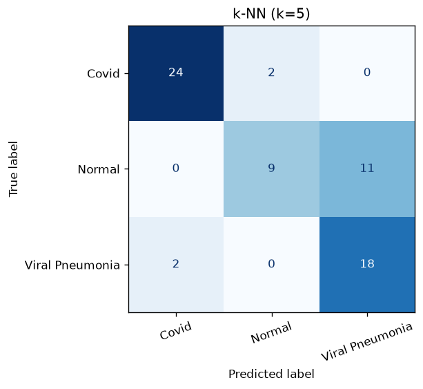
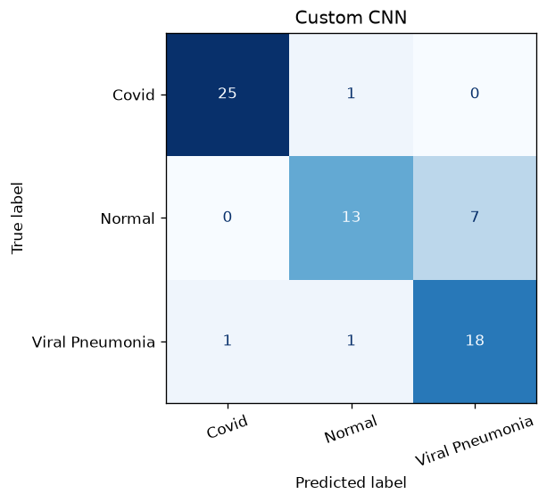
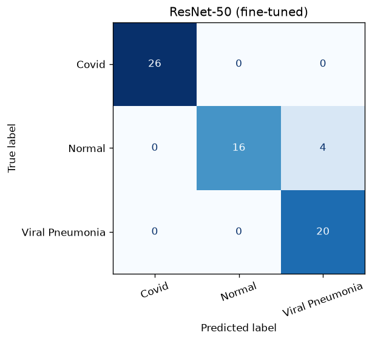
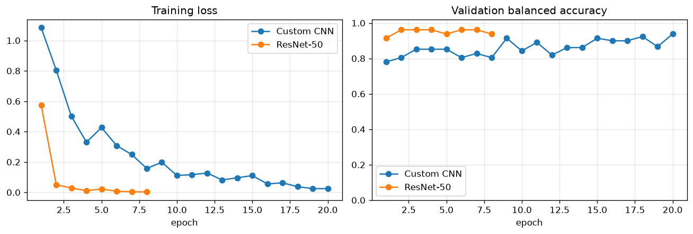
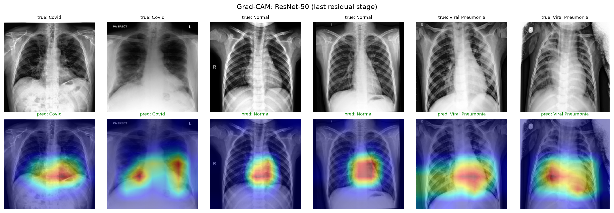
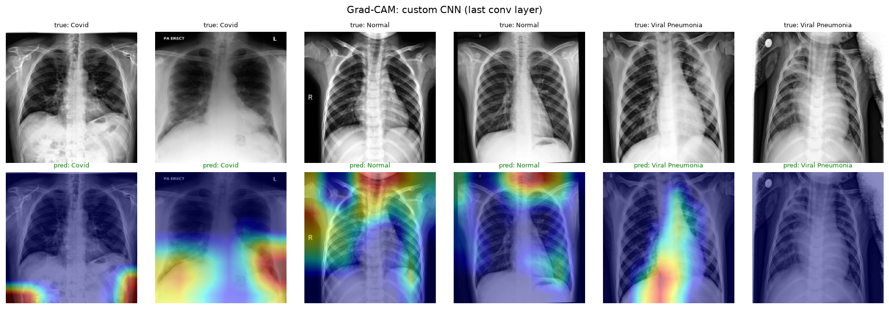

# Chest X-ray Classification: COVID-19 · Viral Pneumonia · Normal

[](https://colab.research.google.com/github/LittleIronclad/covid-xray-classification/blob/main/notebooks/covid_xray_classification.ipynb)


Three-class classification of chest radiographs, comparing models of increasing capacity — a pixel-space **k-NN** baseline, a **custom CNN trained from scratch**, and a fine-tuned **ResNet-50** — with **Grad-CAM** to check what the networks actually look at.

<p align="center"></p>

## Highlights

- **Leakage-free evaluation.** The official test split is never augmented or used for model selection; a stratified validation split is taken *before* augmentation.
- **Class imbalance handled in training, not in the test set.** A weighted sampler with on-the-fly augmentation in training; balanced accuracy and macro-F1 for reporting.
- **Test-time augmentation (TTA).** Predictions are averaged over flipped and rotated views of each test image.
- **Interpretability.** Grad-CAM maps for both networks, used to check whether attention falls on the lung fields or on dataset artefacts.
- **Reproducible.** Fixed seeds, deterministic cuDNN, a single notebook that runs top-to-bottom on a free Colab GPU in about 10 minutes.

## Models

| Model | Description |
|---|---|
| k-NN | 64×64 grayscale pixels, `k` chosen on validation |
| **Custom CNN** | 4 × (7×7 conv + spectral norm + ReLU + max-pool) → FC 256 → 84 → 3; ~234k parameters, SGD with momentum |
| ResNet-50 | ImageNet-pretrained, final layer replaced, fully fine-tuned with Adam (lr 1e-4) |

Spectral normalization bounds the Lipschitz constant of each convolution. With only ~200 training images it noticeably stabilised training of the from-scratch network.

## Results

Evaluated on the untouched test set of 66 images (26 COVID, 20 Normal, 20 Viral Pneumonia). Trained on an Apple M4 (MPS).

| Model | Accuracy | Balanced accuracy | Macro-F1 |
|---|---:|---:|---:|
| k-NN (k = 5) | 0.773 | 0.758 | 0.746 |
| **Custom CNN** (from scratch, 234k params) | 0.848 | 0.837 | 0.835 |
| **Custom CNN + TTA** | 0.864 | 0.850 | 0.849 |
| ResNet-50 (fine-tuned) | 0.939 | 0.933 | 0.933 |
| ResNet-50 + TTA | **0.970** | **0.967** | **0.967** |

<p align="center">
    
</p>

**Takeaways**
- Each step up in model capacity helps: the from-scratch CNN gains about 8 points over pixel-space k-NN, and ImageNet pre-training adds about 10 more.
- **TTA helps consistently**: +1.3 points balanced accuracy for the CNN and +3.4 for ResNet-50, at no training cost.
- **COVID is the easiest class** (ResNet-50: 26/26). Almost all remaining errors are **Normal → Viral Pneumonia** confusions, which is plausible clinically: early or mild viral pneumonia can look close to normal.

<p align="center"></p>

### What do the networks look at? (Grad-CAM)

<p align="center"></p>
<p align="center"></p>

ResNet-50 concentrates on the thorax: the lung bases and the mediastinum. The small custom CNN reaches correct predictions in some cases while attending to regions **outside the lungs**, such as the neck and upper image border or the abdomen. This is a typical sign of **shortcut learning**: the model picks up acquisition cues that correlate with the class. It is why the CNN's score should be read with the caveats below.

## Repository structure

```
notebooks/covid_xray_classification.ipynb   end-to-end pipeline with outputs: EDA → models → TTA → Grad-CAM → results
figures/                                    plots produced by the notebook
results.csv                                 final metrics
requirements.txt
```

## How to run

**Colab (recommended):** click the badge above → *Runtime → Change runtime type → GPU* → *Run all*. The dataset is downloaded automatically via `kagglehub`.

**Locally:**
```bash
pip install -r requirements.txt
jupyter notebook notebooks/covid_xray_classification.ipynb
```
To use a local copy of the data, unzip it so that `Covid19-dataset/` sits in the repository root (or set `DATA_DIR`). On Apple Silicon Macs the notebook uses the GPU via MPS automatically.

## Data

[COVID-19 Image Dataset](https://www.kaggle.com/datasets/pranavraikokte/covid19-image-dataset) by Pranav Raikokte (Kaggle). It has 317 chest X-rays, pre-split into train (251) and test (66). The data is not redistributed in this repository.

## Limitations

- **Small test set.** With 66 images, a single error changes accuracy by about 1.5 points, so small differences between models are within noise.
- **Shortcut risk / source confounding.** The classes come from different public collections. The COVID images are adult radiographs, many carrying Italian positioning labels ("SEDUTO", "A LETTO"), while most Normal and Viral Pneumonia images look paediatric and come from another source. Image resolution also differs systematically by class. A model can therefore partly learn *where an image came from* rather than the pathology, and the Grad-CAM maps of the custom CNN show exactly this kind of behaviour. A real clinical claim would require external validation on data from another institution.
- **Horizontal flips** are anatomically unrealistic for chest radiographs. They are used only as a light regulariser.
- This is a research and education project, **not a diagnostic tool**.

## Context & credits

Two-person team project for the Scientific Research Seminar *"Artificial Neural Networks and Machine Learning"* at HSE University (2025).

- **Alexey Potemkin**: designed, implemented and trained the custom CNN; co-developed data exploration and preprocessing.
- **Teammate**: k-NN baseline and ResNet-50 transfer learning; co-developed data exploration and preprocessing.

This repository is a cleaned-up, English-language version of the original course notebook. The main change is the evaluation protocol: no augmentation of the test set, a validation split taken before augmentation, balanced metrics, and TTA.

## License

MIT. See [LICENSE](LICENSE).
